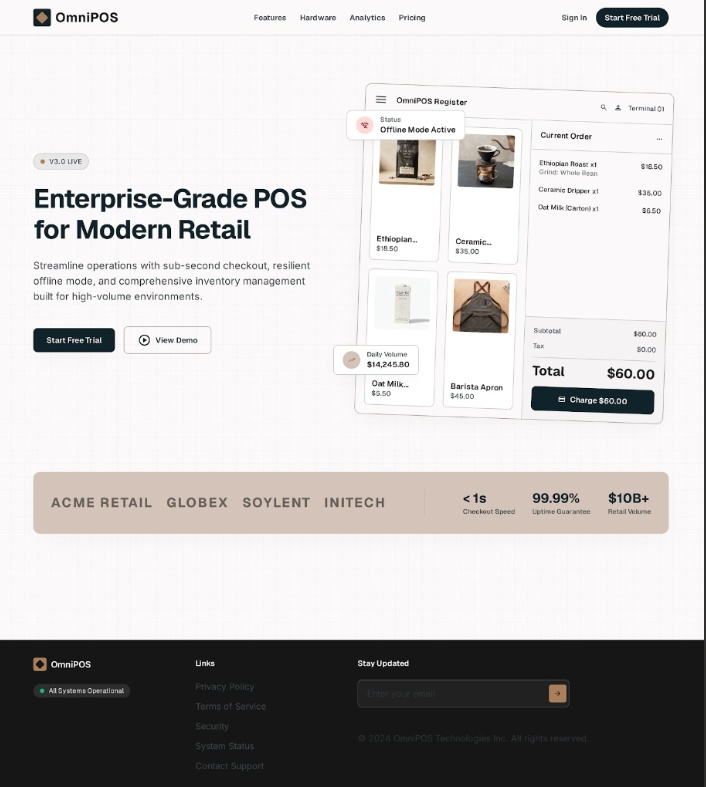

# OmniPOS Landing Page

A responsive B2B SaaS landing page concept for OmniPOS, a retail point-of-sale and inventory platform for boutiques and multi-branch stores.

**[View the live demo](https://saad-collabk.github.io/Omni-Saas-landing-page/)**

## Highlights

- Interactive POS interface mockup with product catalog, cart, and checkout flow
- Feature grid covering multi-location inventory, offline use, staff roles, and audit logs
- Hardware showcase for tablet docks, barcode scanners, and receipt printers
- Pricing section with a monthly/annual billing toggle
- Responsive layout and custom retail-focused visual design

## Built with

- Semantic HTML5
- Tailwind CSS via CDN
- Geist, Inter, and JetBrains Mono typography
- Google Material Symbols

## Run locally

Clone the repository and open index.html in a browser. The Tailwind CSS CDN requires an internet connection.

## Repository files

- index.html — landing page
- screen.png — preview image
- LICENSE — MIT License

## License

This project is available under the MIT License. See [LICENSE](LICENSE).
